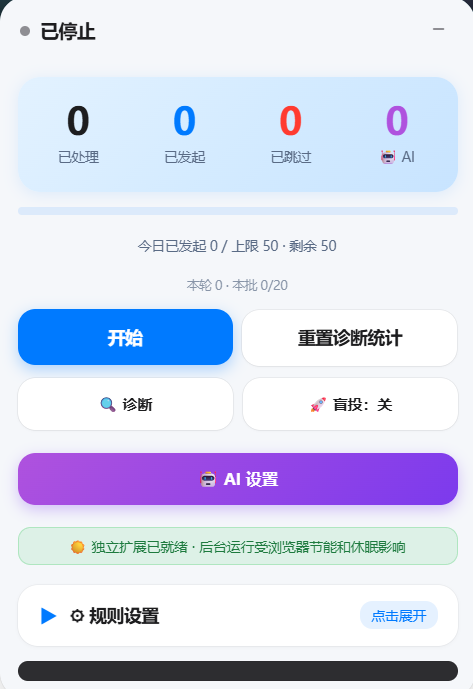
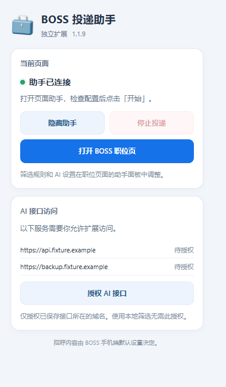
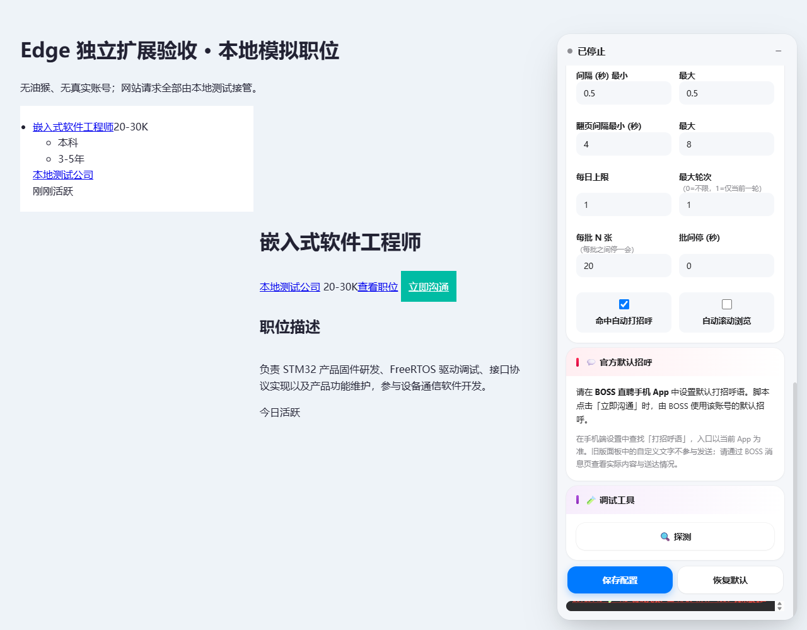

<p align="center">
  
</p>

<h1 align="center">BOSS海投助手</h1>

<h3 align="center">让投递更有方向，让重复操作更少。</h3>

<p align="center">
  在 BOSS 职位页集中管理岗位筛选、AI 判断与投递节奏。<br>
  独立 Edge 扩展，无需油猴；规则自己定，过程看得见。
</p>

<p align="center">
  <a href="extension/manifest.json"></a>
  
  
  <a href="https://github.com/hxhxhxhy1226/BOSS-Haitou-Helper/stargazers"></a>
</p>

<p align="center">
  <a href="https://github.com/hxhxhxhy1226/BOSS-Haitou-Helper/archive/refs/heads/develop.zip"><strong>下载源码 ZIP</strong></a>
  · <a href="#快速开始">安装指南</a>
  · <a href="#ai-筛选">AI 配置</a>
  · <a href="#界面预览">界面预览</a>
  · <a href="VALIDATION.md">验证报告</a>
</p>

---

## 功能亮点

| 能力 | 可以做什么 |
| --- | --- |
| **独立运行** | 直接安装到 Edge，通过岗位页面板和浏览器工具栏控制助手。 |
| **本地岗位筛选** | 按必含词、排除词、年限、学历、薪资和活跃度筛选。 |
| **可选 AI 判断** | 结合求职画像与职位描述判断岗位方向，支持主接口和多个备用接口。 |
| **控制投递节奏** | 设置卡片间隔、翻页间隔、批次、暂停时间和每日上限，随时停止。 |
| **额度与岗位去重** | 扩展后台统一管理多标签额度；实际点击前先持久化占额，避免重复发起。 |
| **状态清楚可查** | 区分官方确认、待确认和失败，保留日志与岗位标记。 |

配置和额度保存在扩展本地存储中，AI Key 不写入 BOSS 网页的 localStorage。参数保存后更新当前页面的运行配置；已经停止的任务需要再次点击“开始”。

## 快速开始

**普通用户只需要 Microsoft Edge，不需要安装 Node.js、Python 或油猴。**

1. [下载 develop 分支源码 ZIP](https://github.com/hxhxhxhy1226/BOSS-Haitou-Helper/archive/refs/heads/develop.zip)，解压到一个固定文件夹。
2. 在 Edge 地址栏输入 `edge://extensions`，开启“开发者模式”。
3. 点击“加载解压缩的扩展”，选择解压后项目中的 **`extension` 文件夹**，确认该文件夹直接包含 `manifest.json`。
4. 刷新 BOSS 职位页面，在助手面板中填写并保存筛选条件。如果以前启用过油猴版助手，先停用旧脚本。
5. 点击面板的“开始”。工具栏弹窗可以显示或隐藏面板，也可以停止当前页面任务。

扩展加载、打开职位详情或保存配置，本身都不会自动开始投递。不要把 ZIP 文件直接拖进扩展页；安装后请保留文件夹位置。更新代码后，在扩展管理页点击该扩展的刷新按钮，再刷新 BOSS 页面。

### 设置打招呼内容

请先在 **BOSS 直聘手机 App** 中设置账号的默认打招呼语。助手点击网页的官方“立即沟通”按钮，由 BOSS 使用该账号默认内容；扩展不覆盖话术，也不追加自定义消息。

AI 通过后会继续定位当前岗位的“立即沟通”按钮；页面重建同岗位按钮时会重新定位，点击前停止或岗位内容改变时会撤销本次占额。出现“已向BOSS发送消息”等明确提示，或本次按钮变为“继续沟通”时，卡片显示绿色“完成”。助手先点击成功框里的“留在此页”，等待弹窗关闭，再处理下一家；无法关闭时停止推进，保留已经完成的结果。鼠标悬停可查看完整说明。

尚无官方回执时会临时显示“待确认”；最近一笔投递在一分钟内收到迟到回执时，会更新原卡片并清理成功弹窗，用户已停止运行也能完成这一步。

“已发起”记录的是助手发起的沟通操作。结果待确认时仍保留占额和去重记录，实际内容与送达状态以 BOSS 消息页为准。旧版本留下的待确认记录无法仅凭按钮文字判断是否发送，不会自动清除后重复投递。

## AI 筛选

AI 为可选功能。关闭 AI 即可使用本地规则筛选，无需授权 AI 服务域名。

1. 打开岗位页面板的“AI 设置”，填写 OpenAI 兼容的 **Chat Completions** 接口地址、API Key 和模型。地址填到 `/v1` 时会自动补全路径。
2. 填写求职画像，描述目标岗位、技术方向及明确的筛选条件。
3. 保存配置，打开 Edge 工具栏中的助手弹窗，点击 **“授权 AI 接口”**，允许访问已配置的服务域名。
4. 回到 AI 设置测试连接，确认可用后开启 AI 筛选并保存，再开始处理岗位。

可以添加多个备用接口，调整顺序或单独停用。接口不可用时尝试其他已启用接口；全部不可用时，按所选策略执行“本地排除词复核”“跳过该职位”或“暂停等人工”。如果要求每个岗位都经过 AI 确认，请选择跳过或暂停。

“拉取”读取当前填写的接口和 Key，直接展示模型列表，无需重复确认保存；点击模型后保存当前配置。关闭模型列表不会改写模型名，关闭 AI 设置时仍会提醒实际未保存的修改。保存失败会在模型选择窗口显示原因，可重试。

接口测试读取当前输入。缺少域名权限时会提示先授权；请求由扩展后台发往你配置的服务。职位描述和求职画像会提供给该服务，费用以供应商计费为准。AI 额度按请求尝试保守占用，连接测试、失败和缺少授权的尝试也可能计入；缓存命中不消耗新请求额度。

<details>
<summary><strong>查看参数在本地模式与 AI 模式下的作用</strong></summary>

| 参数 | 生效方式 |
| --- | --- |
| 必含词、排除词 | 本地模式按文字规则匹配；AI 模式结合岗位上下文判断。 |
| 年限、学历 | 本地模式使用面板条件；AI 模式默认不以这些要求拒绝，只有画像明确提出相关筛选条件才采用。 |
| 薪资 | 本地模式检查可识别月薪；AI 模式结合职位信息判断。 |
| 活跃度 | 两种模式均本地检查；未标注或无法识别时不据此拒绝。 |
| 卡片间隔、翻页间隔 | 保存后用于下一次相应等待；当前已经开始的等待先走完。 |
| 批次、批间暂停 | 保存后更新阈值；当前批间休息按新总秒数继续或结束，不从零重计。 |
| 最大轮次 | `0` 表示不限，`1` 表示一轮。 |
| 每日上限 | 保存后参与实际沟通前复查，不清空当日已发起次数。 |
| 自动打招呼、自动滚动 | 保存后采用新开关；关闭自动打招呼仍可筛选。 |
| AI 画像、接口及策略 | 保存后参与后续判断，相关条件变化后旧缓存作废。 |

已经处理过的岗位不会因修改设置立即重新投递。修改画像和规则后，后续判断会使用新条件。

</details>

## 界面预览

<table align="center">
  <tr>
    <th align="center">投递主面板</th>
    <th align="center">浏览器工具栏</th>
  </tr>
  <tr>
    <td align="center" valign="top"></td>
    <td align="center" valign="top"></td>
  </tr>
  <tr>
    <td align="center">查看投递统计，配置规则与 AI，开始或停止任务。</td>
    <td align="center">查看连接状态，控制面板与接口授权。</td>
  </tr>
</table>

<details>
<summary><strong>展开查看岗位页完整演示</strong></summary>



</details>

投递主面板截图由用户提供；工具栏和完整岗位页截图来自本地模拟演示。图片用于展示界面，不代表消息已送达或 HR 已读。

## 开发与打包

开发环境需要 **Node.js 24.15.0 或更新版本**，以及 **Python 3**。Python 仅用于标准库 ZIP 打包，无需安装额外 Python 包。

```sh
npm ci
npm run check
npm test
npm run build
```

构建后得到：

| 输出 | 用途 |
| --- | --- |
| `dist/boss-helper-edge-1.1.2/` | 可直接加载到 Edge 的扩展目录。 |
| `dist/boss-helper-edge-1.1.2.zip` | 安装包，解压后加载。 |
| `dist/boss-helper-edge-1.1.2-github.zip` | 源码、测试、依赖锁文件和 GitHub Actions。 |

Windows 安装了 Edge 时，可运行 `npm run test:edge`。它在独立测试目录中加载真正的扩展，通过本地模拟页面检查注入、保存、额度、停止和工具栏功能；`EDGE_BINARY` 可指定 Edge 可执行文件路径。

当前 **1.1.2** 修复成功弹窗识别、关闭顺序和完成标签，Edge 实际加载的 16 项本地模拟检查通过。`check` 校验 Manifest V3、资源引用、JavaScript 语法与版本一致性；GitHub Actions 执行依赖安装、检查、测试与打包。具体结果与范围见 [验证报告](VALIDATION.md)，版本变化见 [更新记录](CHANGELOG.md)。

正式图标位于 `extension/icons/`，公文包图标的可编辑源和 512px 原图位于 `design/briefcase/`。扩展运行只使用打包后的本地代码，开发依赖和图标生成工具不进入运行包。

## 使用说明

- **从油猴版切换**：独立扩展无法读取油猴私有存储，旧配置和当日额度不会自动迁移。请停用旧脚本，再重新填写配置。
- **发送结果**：官方确认、待确认和失败是不同状态；“已发起”不等于简历已送达或 HR 已读。实际结果以 BOSS 消息页为准。
- **后台运行**：Edge 节能、标签页休眠和系统休眠都可能暂停页面执行。
- **验证范围**：自动化与浏览器检查使用模拟岗位和响应，没有向真实招聘方发送消息，也不能替代真实账号的页面权限及服务端发送确认。
